{width=85% fig-align="center"}

# Introduction

## Research question

> **Who rides Boston's fare-free bus routes, and how did ridership and service on these routes change over the years, compared with similar routes that kept regular fares?**

## Why this question?

For many city residents, public transit is the main way to reach jobs, school and health care, yet less than half the world's urban population has convenient access to it [@un_sdg_2020]. People without good transit face longer and less safe commutes [@worldbank_road_safety], higher costs, and exclusion from economic and social opportunities [@lse_transport]. Service that is frequent and reliable is what lets people depend on transit for daily needs [@itdp_2024].

## Why Boston?

Boston's rapid transit lines largely bypass Roxbury, Dorchester and Mattapan, which are lower-income neighbourhoods with mostly residents of colour, leaving them dependent on buses [@cook_thesis_2024]. Boston's fare-free bus program was designed to address this gap. Using federal pandemic relief funds, the City made Route 28 free as a pilot in **August 2021**, reimbursing the MBTA for each ride. After early results showed ridership gains and high rider satisfaction, the program expanded to Routes 23 and 29 in **March 2022** [@boston_fare_free_program]. It has since been extended through **December 31, 2026**, with no decision yet on what comes next [@boston_extension_2026].

We compare the fare-free routes (**23, 28, 29**) with **Route 22**, which runs through the same neighbourhoods but still charges a fare.

# Data

We combine seven public datasets (@tbl-data). Routes link across datasets through their MBTA route IDs, and neighbourhoods through census tract IDs.

| Dataset | Source | Years | Used for |
|---|---|---|---|
| Bus ridership by trip, season, route and stop | MassDOT [@mbta_ridership] | Fall 2016–2025 | Weekday riders on each route |
| Bus arrival and departure times | MBTA [@mbta_arrival_departure] | 2020–2025 | Service (trips run) |
| Systemwide Passenger Survey | CTPS [@ctps_survey_2017] | 2015–2017 | Riders before the program |
| System-Wide Passenger Survey | MassDOT [@mbta_survey_2025] | 2022–2025 | Riders during the program |
| American Community Survey, 5-year | U.S. Census Bureau [@acs_5year] | 2015–19, 2020–24 | Who lives along each route |
| TIGER/Line census tracts | U.S. Census Bureau [@tiger_tracts] | 2019, 2024 | Neighbourhood maps |
| GTFS schedule data | MBTA [@mbta_gtfs] | 2026 | Stop locations and route paths |

: Data sources {#tbl-data}

Ridership comes from **automatic passenger counters** rather than fare data: riders on the fare-free routes do not tap a fare card, so fare data cannot count them, while passenger counters measure everyone who boards in the same way before and after the program.

# Methods

## Comparison design

We use a **difference-in-differences** comparison [@angrist_pischke_2009]: the change on the fare-free routes minus the change on a comparison route over the same period. This removes changes that affected every route, such as COVID and remote work, leaving the difference linked to free fares. The main comparison is **Route 22**; we check the result against the **8 busiest other routes** (1, 66, 39, 57, 111, 32, 22 and 9) and **all other routes**. Silver Line routes are excluded because they are bus rapid transit with different ridership drivers.

## Adjusting for service

A route that loses buses loses riders, regardless of the fare. Therefore, we also measure ridership **relative to service**, the change in riders per trip run:

$$
\text{Adjusted change} = \left(\frac{1 + \text{riders change}/100}{1 + \text{service change}/100} - 1\right) \times 100
$$

For example, Route 23's riders rose 1.0% while its service fell 7.2%: 1.010 ÷ 0.928 = 1.088, so riders per trip rose 8.8%.

**Periods:** riders are compared from Fall 2019 to Fall 2025. Service data begins in 2020, so service is compared from January–February 2020 (before COVID and the program) to January–February 2025.

# Findings

## Who lives along the routes and who rides them

The three fare-free routes and Route 22 serve similar neighbourhoods. Figure @fig-income-map locates the four routes and shows the tract-level income pattern across the two ACS periods. The same route geometry is used on both panels, so the map compares ACS geography and income rather than historical route changes.

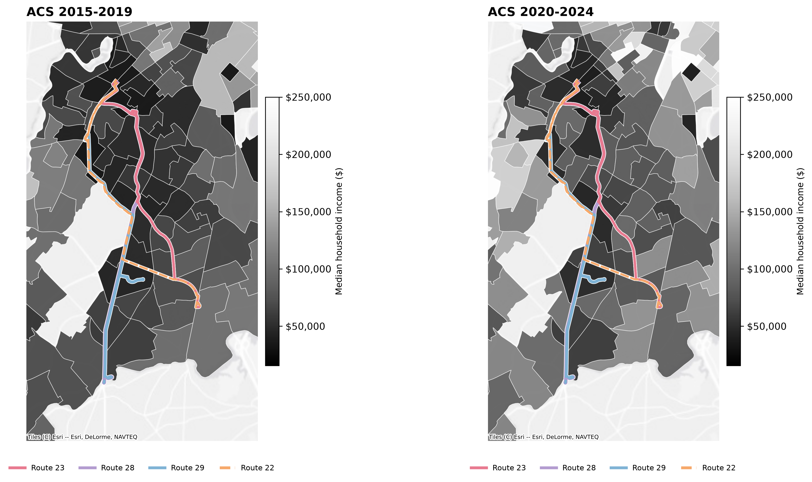{#fig-income-map width=95%}

Figure @fig-route-characteristics compares residents, median income, poverty, vehicle access, minority share, and rent burden in each route area across the two ACS periods. Route areas can overlap, so resident counts are not unique populations.

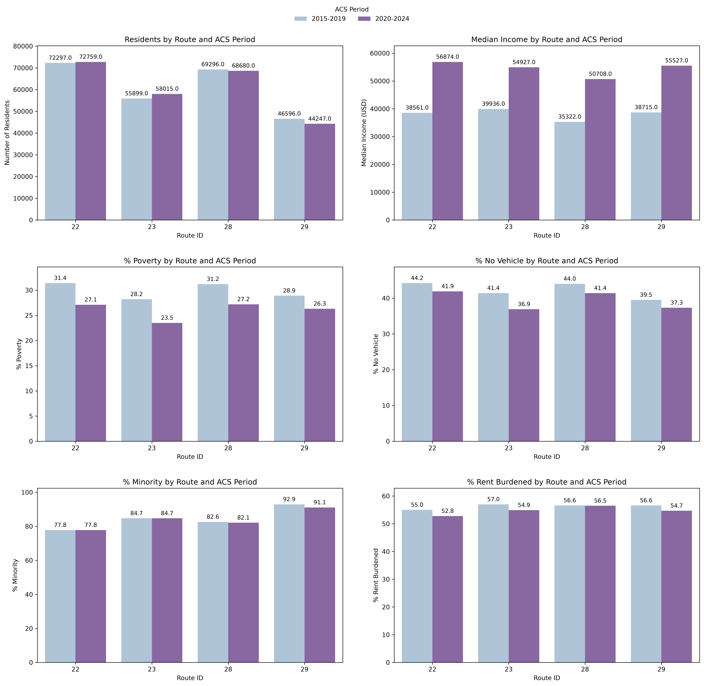{#fig-route-characteristics width=95%}

The riders on these routes also share similar characteristics (@fig-rider-characteristics). Riders on all four routes are more likely to be people of colour and to live without a car than the average MBTA bus rider. They are also slightly less likely to be commuting to work. Routes 28 and 29 are reported together in the survey.

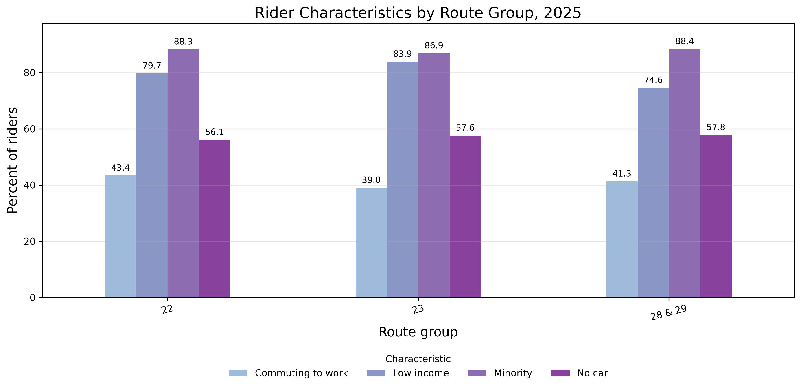{#fig-rider-characteristics width=95%}

**Did free fares change who rides?** Route 23 is the only fare-free route reported separately in both surveys. Compared with all bus riders in the same year (@tbl-ridermix), Route 23's riders remain more car-free and less likely to commute to work, and they remain more likely to be low-income and people of colour. The program kept serving the same kind of riders rather than attracting a different, better-off group.

| | Route 23, 2015–17 | All buses, 2015–17 | Route 23, 2025 | All buses, 2025 |
|---|---:|---:|---:|---:|
| Low-income | 59.0% | 41.4% | 83.9% | 77.6% |
| Minority | 84.9% | 48.1% | 86.9% | 69.4% |
| No car in household | 47.1% | 39.0% | 57.6% | 48.6% |
| Commuting to work | 59.5% | 69.8% | 39.0% | 47.3% |

: Route 23 riders compared with all bus riders, before and during the program {#tbl-ridermix}

Two cautions apply to @tbl-ridermix. The MBTA's definition of "low-income" changed between the surveys, so low-income shares should be compared within a year, not across years. And the fall in work trips happened on every route, reflecting the rise of remote work rather than the fare change.

## Ridership on the fare-free routes

{#fig-riders-trend width=95%}

All four routes collapsed in 2020 (@fig-riders-trend). Route 28 rebounded sharply in its first fare-free fall (2021), and Route 23 climbed back to its pre-COVID level after becoming free in 2022. Route 22, which kept its fare, is still below its 2019 ridership. Route 29 stayed low, reflecting the service cuts described below.

Boardings per 100 residents provide another way to compare route activity with the size of nearby populations (@fig-resident-ridership). These are boardings, not counts of unique residents who ride; route areas can overlap and riders may live outside them.

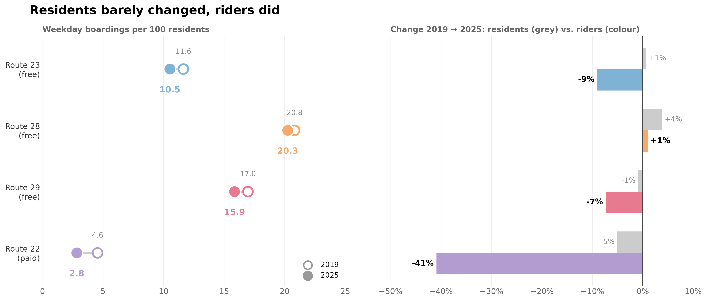{#fig-resident-ridership width=95%}

### Did neighbourhood conditions change with ridership?

The next figures compare route-area characteristics with the change in weekday riders from 2019 to 2025. They show associations across routes, not evidence that demographic changes caused ridership changes.

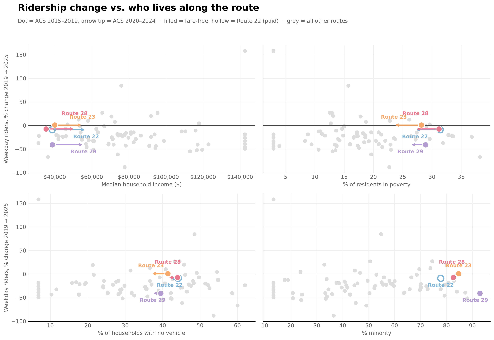{#fig-demographics-ridership width=95%}

The income-focused views show the relationship both with the later-period income level (@fig-income-level-ridership) and with the percentage change in income (@fig-income-change-ridership). The income-change measure is nominal and is not adjusted for inflation.

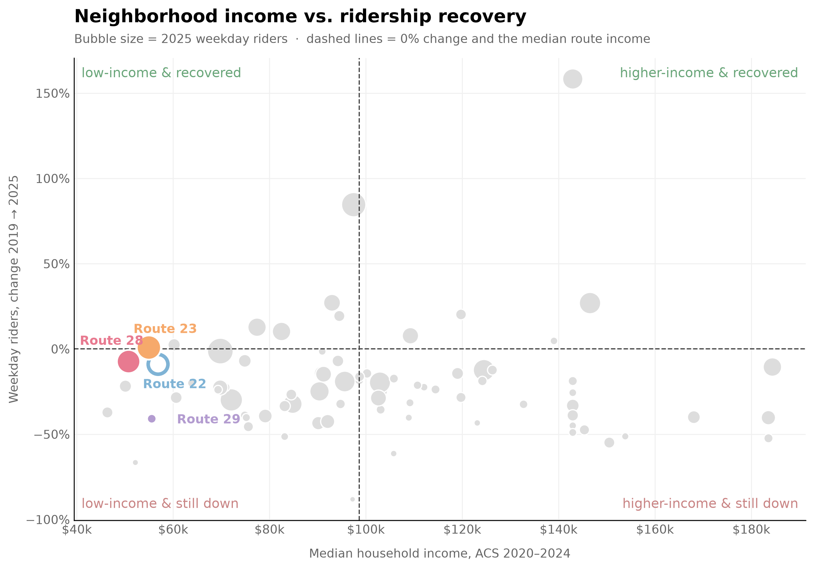{#fig-income-level-ridership width=95%}

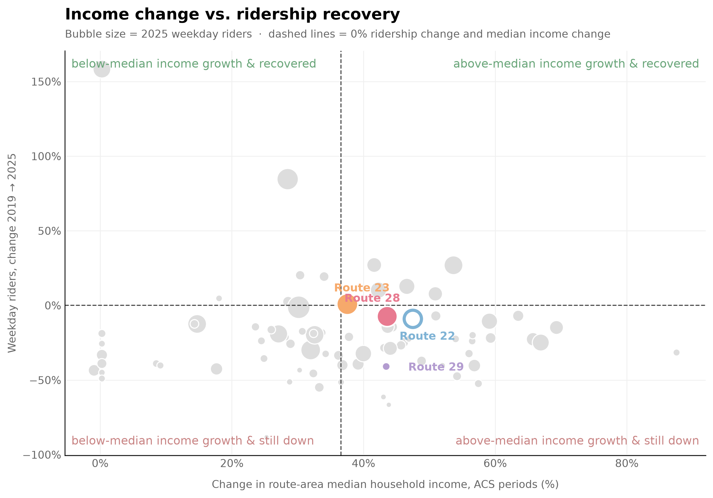{#fig-income-change-ridership width=95%}

## Did ridership simply follow service?

If the fare-free routes had simply been given more buses, more riders would be expected regardless of the fare. @fig-service shows the opposite.

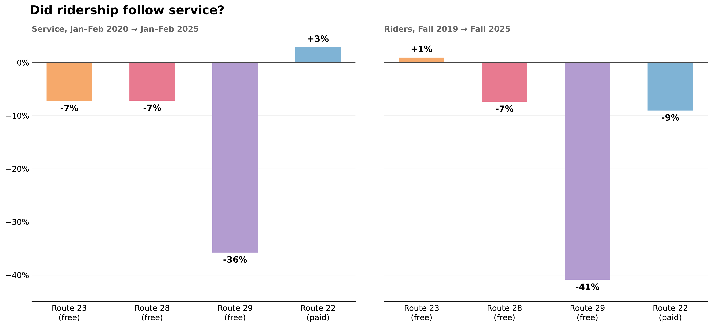{#fig-service width=100%}

| Route | Riders change | Service change | vs. Route 22, raw | vs. Route 22, adjusted for service |
|---|---:|---:|---:|---:|
| 23 (free) | +1.0% | −7.2% | +10.0 pts | **+20.4 pts** |
| 28 (free) | −7.4% | −7.2% | +1.7 pts | **+11.4 pts** |
| 29 (free) | −40.9% | −35.8% | −31.9 pts | **+3.6 pts** |
| 22 (paid) | −9.0% | +2.9% | — | — |

: Riders and service on the four routes. Riders: Fall 2019 → Fall 2025; service: January–February 2020 → January–February 2025. {#tbl-service}

Route 22 gained 2.9% more service but still lost 9.0% of its riders (@tbl-service). Route 23 lost 7.2% of its service yet gained riders, and Route 28 lost riders only in line with its service cut. Route 29's ridership fell almost as far as its service: free fares could not offset deep service cuts.

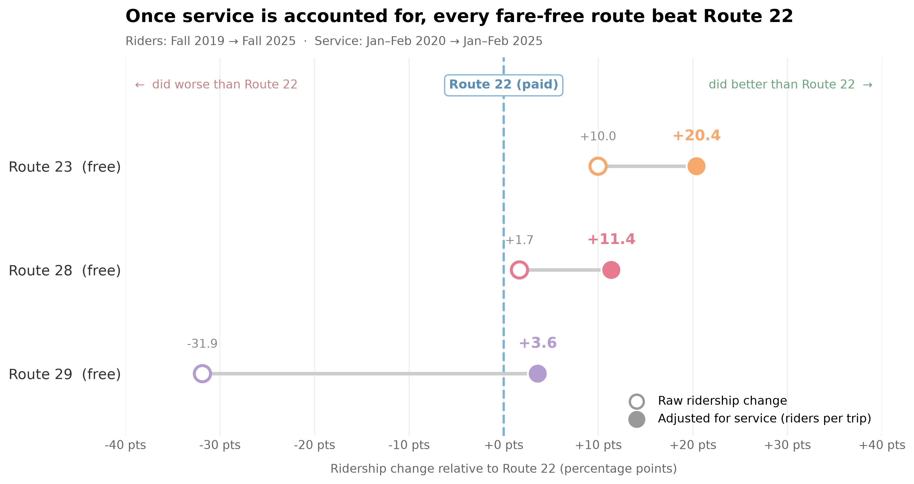{#fig-adjusted width=95%}

Because Route 22 gained service while the fare-free routes lost it, the raw comparison understates the fare-free routes' advantage. Once ridership is measured relative to service (@fig-adjusted), **all three fare-free routes outperformed Route 22**: Route 23 by 20.4 percentage points, Route 28 by 11.4 and Route 29 by 3.6. Ridership usually falls less than one-for-one with service, so these adjusted gaps are an upper estimate; the true effect lies between the raw and adjusted values.

## The fare-free routes in the wider network

Across the network, the fare-free routes recovered far more of their pre-COVID riders than other routes (@tbl-network).

| Group | Change in weekday riders, Fall 2019 → Fall 2025 |
|---|---:|
| Fare-free routes (23, 28, 29) | −6.3% |
| 8 busiest other routes | −18.7% |
| All other routes | −22.8% |

: Change in total weekday riders by group (Silver Line excluded) {#tbl-network}

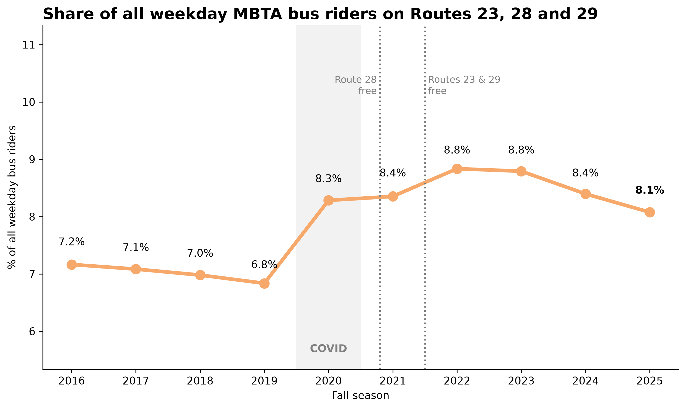{#fig-share width=95%}

The fare-free routes' share of all weekday bus riders rose from 6.8% in 2019 to 8.8% in 2022–2023, before easing to 8.1% in 2025 (@fig-share). Much of the jump happened in 2020, before fares were removed, as riders on these routes kept riding through COVID more than riders elsewhere; the rise after 2021 (8.4% to 8.8%) is the part more plausibly linked to free fares.

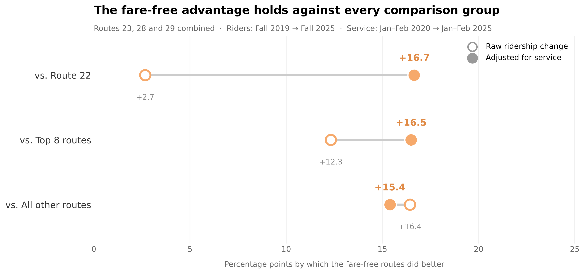{#fig-robust width=95%}

The result does not depend on choosing Route 22 (@fig-robust, @tbl-robust). After adjusting for service, the fare-free routes did 15.4 to 16.7 points better than every comparison group, a remarkably consistent result.

| Fare-free routes compared with | Raw gap | Gap adjusted for service |
|---|---:|---:|
| Route 22 | +2.7 pts | +16.7 pts |
| 8 busiest other routes | +12.3 pts | +16.5 pts |
| All other routes | +16.4 pts | +15.4 pts |

: Fare-free routes (combined) compared with each group, Fall 2019 → Fall 2025 {#tbl-robust}

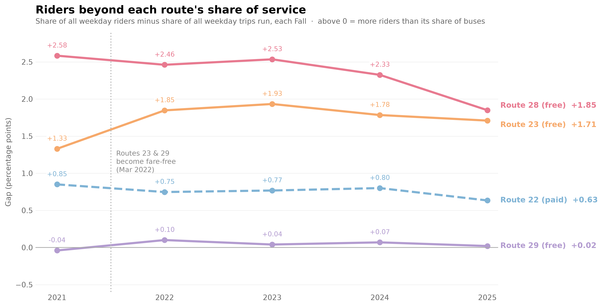{#fig-gap width=95%}

Finally, @fig-gap shows how many more riders each route carries than its share of service would suggest. Route 23's gap rose when it became fare-free (from +1.33 percentage points in 2021 to +1.85 in 2022) and stayed above its pre-program level, while Route 22's gap stayed flat at about +0.6 to +0.85. Route 28, already fare-free in 2021, carries the most riders relative to its service of the four routes. Route 29 carries roughly its share of riders for its share of buses.

<!-- TODO: if the walking-areas map is saved, add it here or in the "Who lives along the routes" section:
{#fig-walking width=90%}
-->

# Limitations



# Conclusion

Free fares did not reverse the post-pandemic fall in bus ridership in Boston, but they made a clear difference to how much of it the fare-free routes recovered. From 2019 to 2025, Routes 23, 28 and 29 together lost 6.3% of their weekday riders, against 18.7% on the busiest other routes and 22.8% across the rest of the network. This was not because they received more buses: Route 22, which kept its fare, gained service but lost riders, while the fare-free routes lost service and still held on to theirs. Once service changes are taken into account, all three fare-free routes outperformed Route 22, and the advantage of roughly 15–17 percentage points is consistent across every comparison group.

The program also kept serving the riders it was designed for: people in lower-income, transit-dependent neighbourhoods, most of them people of colour and many without a car. Route 29 shows the limit of the policy. Its service was cut by more than a third and its ridership fell almost as much, so free fares cannot substitute for frequent, reliable service. As the City decides what happens after December 2026, the evidence suggests that removing fares helps routes hold on to riders, but only alongside maintaining the service those riders depend on.

Future research could examine whether these ridership trends continue beyond 2026, particularly if the fare-free program is extended or discontinued. More detailed data on service frequency, reliability and passenger travel patterns would help separate the effects of free fares from changes in bus service and post-pandemic travel behaviour. Comparing Boston's experience with other cities that have introduced fare-free transit could also help establish whether the results hold beyond these three routes.

# Supplementary Demographic Charts

These figures provide additional views of the route-area and rider characteristics discussed above.

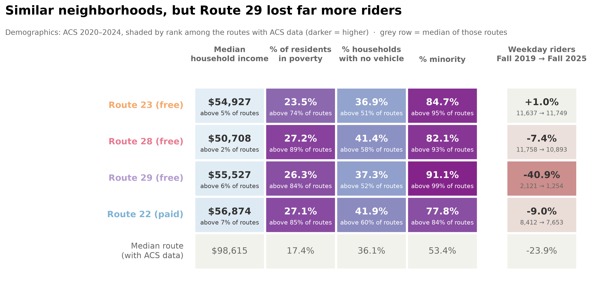{#fig-demographics-table width=95%}

{#fig-no-vehicle width=95%}

# Use of AI tools {.unnumbered}

We used Claude, an AI assistant developed by Anthropic [@anthropic_claude], for support with Python code debugging, chart design and editing text. All analysis decisions, interpretation and final writing are our own, and every result was checked against the data.

# References {.unnumbered}

::: {#refs}
:::
